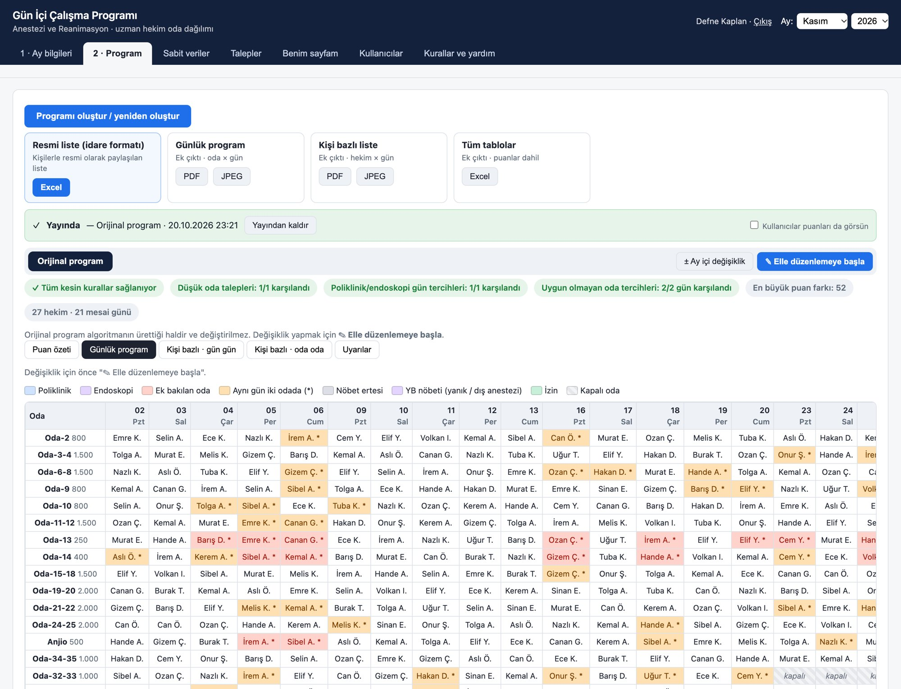
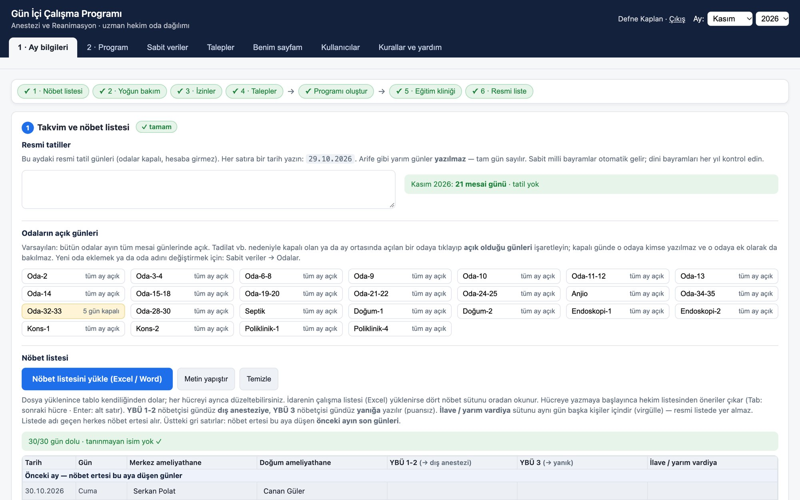
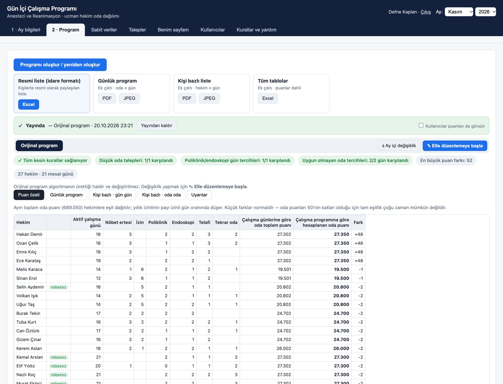

# Daytime Work Schedule

**A rule-based scheduling system that builds fair monthly operating-room assignments for the anesthesiology department of Kayseri City Hospital, Türkiye.**

Every month, one specialist used to assign about 27 anesthesiologists to 25 work areas (operating rooms, outpatient clinics and endoscopy units) for every working day, by hand. This project turns that manual task into a defined process with explicit rules, measurable fairness and an optimisation algorithm. A full month is generated in seconds, and no hard rule is broken.

**▶ Try the live demo (web version, fictional data):** https://zeynepececetin.github.io/daytime-work-scheduler/web-demo/

> **Privacy:** every person named in this repository, its sample data and its screenshots is fictional. The real department data is kept out of this repository to comply with Türkiye's personal data protection law (KVKK).

| | |
|---|---|
| Doctors scheduled per month | ~27 |
| Work areas per day | 25 |
| Assignments per month | ~525 |
| Hard-rule violations in test runs | **0** |
| Largest gap from a doctor's fair workload target | ≈ 0.2 % |



---

## The problem, seen as an industrial engineering problem

This is a classic **workforce scheduling and assignment problem**:

- **Resources:** anesthesiologists with different availability (night-shift recovery days, leave, intensive-care rotations, rooms they are exempt from).
- **Demand:** 25 work areas a day, each with a different workload score (200 to 5,000 points).
- **Hard constraints (K1–K15):** for example, no daytime work the day after a night shift, with different rules for Friday and weekend shifts. Other examples: 1–2 clinic and endoscopy days per person in different units, at most two days in the same room, and only specific room pairings when doctors are short.
- **Objective hierarchy:** hard rules first, then individual requests, then preferences, then **fairness**. Each doctor's monthly total is pulled as close as possible to their fair target, which is reduced pro rata for leave. Finally, **rotation**: doctors move through rooms they did not work in last month.
- **Disruption management:** when someone falls ill or a room closes mid-month, the system re-optimises only the remaining days. It offers alternatives from *fewest changes* to *most balanced* and shows the trade-off for each.

The full rule set, which is the system's requirements specification, is in [`KURALLAR.md`](KURALLAR.md) (Turkish).

## Zeynep's role

**Zeynep Ece Cetin** identified the need, proposed the project and led it as its owner. She worked on it from the first day to the last, approaching it as an **industrial / systems engineer**:

- **Problem definition:** framed a manual, error-prone monthly task as a scheduling problem with resources, demand, constraints and objectives.
- **Requirements engineering:** helped turn the department's unwritten practice into precise, numbered rules (hard rules, goals, preferences) and a clear priority order between them.
- **Process design:** worked on fitting the program to the department's real monthly workflow (calendar and roster → intensive-care staff → leave → requests → generate → review → official list).
- **Design and development:** took part in the design-and-test sessions throughout the project.
- **Testing and iteration:** tested the program and gathered feedback from the doctors who use it. Their feedback was turned into new rules and features, such as the room-pairing rule, closed rooms, manual edits and mid-month revisions.

The department's scheduling rules were provided by a specialist anesthesiologist, who also tested the program in real use.

**How it was built:** the project was carried out by Zeynep together with Anthropic's **Claude**, which wrote the code through many design-and-test sessions driven by the department's real needs.

## How it works



1. **Calendar & night-shift roster:** holidays, room availability, the four duty columns (can be read from the administration's Excel file).
2. **Intensive-care staff:** who is outside the daytime schedule this month.
3. **Leave:** annual, congress, sick and other leave (reduces the fairness target proportionally).
4. **Personal requests:** preferred clinic/endoscopy days, rooms to avoid on given days.
5. **Generate & review:** the algorithm builds the month; a control table flags any day with more doctors than open rooms.
6. **Training clinic & official list:** exported in the hospital administration's own 50-column Excel template.

**Algorithm:** simulated annealing over the space of possible assignments (`kaynak/core.js`). Hard rules are never violated, and the remaining objectives are optimised in a fixed priority order.

**Control stays with people:** the algorithm's original schedule is never overwritten. Manual edits happen in a draft with undo/redo. The program reports any rule broken and every change in points, but never blocks the scheduler. Finalised drafts become numbered revisions, and each revision produces a change report (PDF) for the administration.



## Two versions

| | Desktop (in use) | Web (next step) |
|---|---|---|
| File | [`CalismaProgrami.html`](CalismaProgrami.html) | [`web-demo/index.html`](web-demo/index.html) |
| Runs | Offline in Chrome/Edge, from a USB stick, no installation | Browser; demo stores data locally, production will use a server |
| Data | Encrypted data file (AES-256-GCM, PBKDF2) | Invitation-only accounts |
| Extra | | Doctors enter their own leave requests from their phones; scheduler approves day by day; personal schedule page |

The desktop version is used by the department's scheduler, and its first full real month is November 2026. The web version is built from the same source (`kaynak/web/build_web.py`), so every desktop feature carries over. It is not yet live.

## Repository structure

```
CalismaProgrami.html     desktop program (built, single file)
web-demo/index.html      web version demo (built, fictional data)
KURALLAR.md              rules / requirements specification (Turkish)
sample-data/             fictional night-shift roster and leave list for November 2026
docs/                    project portfolio (PDF)
kaynak/                  source code
  core.js                scheduling algorithm, rules, validation
  template.html          user interface
  build.py               builds CalismaProgrami.html
  test.js                rule and fairness tests
  web/                   web-version layers and build script
  portfolyo/             tools that produced the portfolio screenshots, PDF and video
```

The user interface and code comments are in Turkish, because the program is used by a Turkish hospital department.

## Build and test

Requires Python 3 and Node.js.

```bash
cd kaynak
python3 -I build.py                       # → ../CalismaProgrami.html
python3 -I web/build_web.py               # → ../web-demo/index.html
node test.js ../CalismaProgrami.html      # rule/fairness test on the sample month: violations must be 0
REQ=1 node test.js ../CalismaProgrami.html     # with personal requests
CLOSE=1 node test.js ../CalismaProgrami.html   # with closed rooms
REPAIR=1 node test.js ../CalismaProgrami.html  # mid-month revision
PREV=1 node test.js ../CalismaProgrami.html    # month-to-month rotation
```

## Project portfolio

A 9-page overview with screenshots: [`docs/Portfolio-Daytime-Work-Schedule.pdf`](docs/Portfolio-Daytime-Work-Schedule.pdf)
